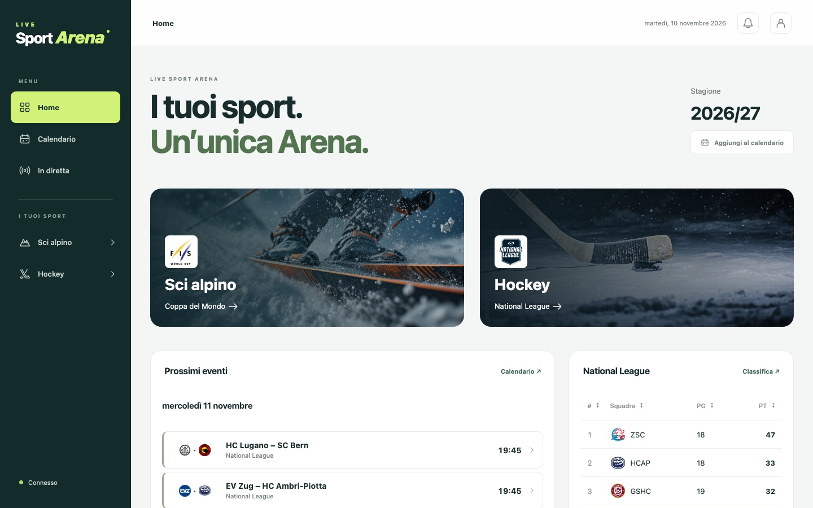
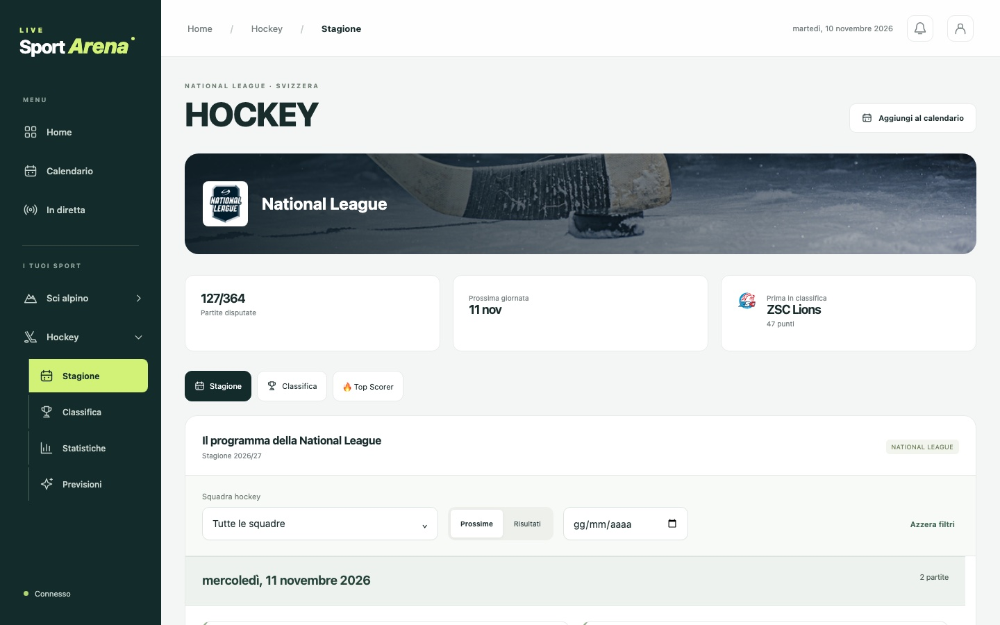
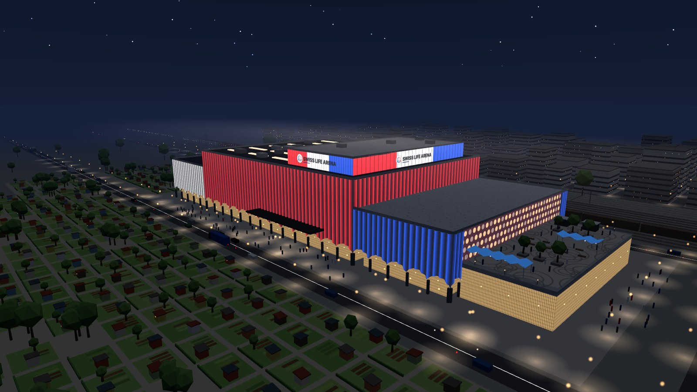
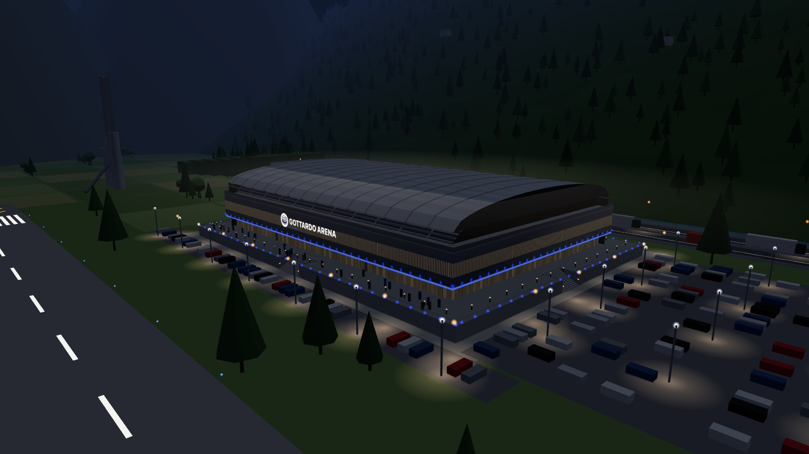
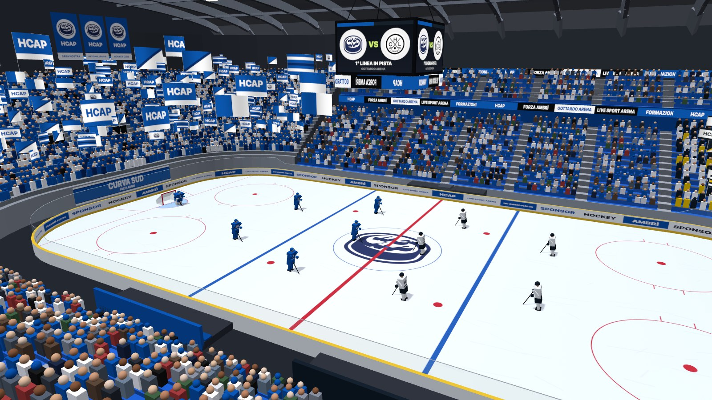
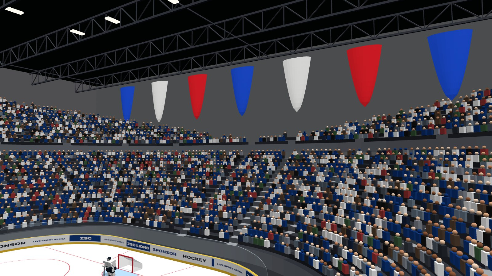
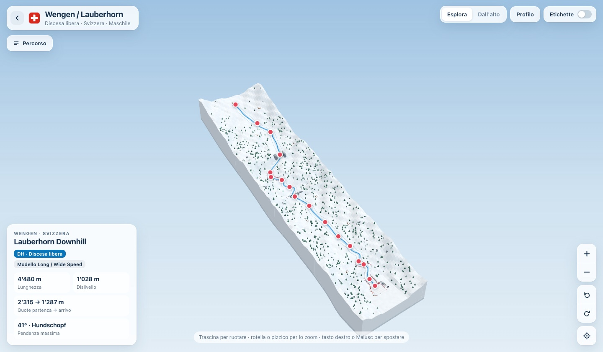
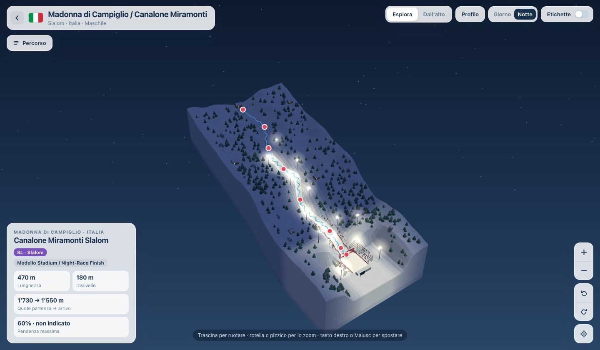

# Hi, I'm Michea 👋

## 🚀 Current Projects

### 🏟️ LiveSportArena

**[livesportarena.ch](https://livesportarena.ch)** · one place for the two sports I follow most: the Alpine Ski World Cup and Swiss National League hockey.
Live results, schedules, standings, statistics, race previews and calendars you can subscribe to, all on a single site that updates itself during the races and the games.

  
  

LiveSportArena is growing into a small ecosystem. Next to the site, three projects add the parts that a results page cannot show:

#### 🏒 3DHockeyArena: the National League arenas in 3D

Interactive 3D versions of the 14 National League arenas, built with three.js. Each arena starts with an aerial intro around the building and its surroundings, which turns from day to night, then flies inside. There you see the stands, the guest sector, the fans and their flags, the video cube and the two line-ups on the ice.
There are no ready-made 3D models: every arena is generated from a short description written from photos and seating plans. Six arenas are finished so far, one at a time.

  
  

  
  

#### ⛷️ 3DSkiTracks: the World Cup courses in 3D

An interactive atlas of the Alpine Ski World Cup courses: 3D terrain, the race line from start to finish, selectable points of interest along the course and several viewing modes, including an evening mode with the floodlit slope.

  
  

#### 📈 National League Analytics: machine learning (coming to LiveSportArena)

A SUPSI university project on Swiss National League hockey analytics, with predictive models for match outcomes and goals. It will become the next component of LiveSportArena, behind the predictions on the site.

### 🧩 Other 2026 projects

- 👁️ Computer Vision Project
- 💻 Mingit

---

## 💼 Favourite Project

✨ **Wallet with SolidPod – [PerkPocket](https://github.com/MicheaColautti/WalletWithSolidPod-PerkPocket)**  
A personal favourite: a modern wallet manager built on SolidPod.

---

## 🎓 SUPSI Projects

### 2025

### 2024

- Monopoly Ascii
- Jarvis

  
<b>2023</b>

 

  
<b>2022</b>

 

  
<b>2021</b>

 

  
<b>2020</b>

 

---

## 📚 Original Projects

Original versions developed with [LuMug](https://github.com/LuMug):

- [Drone](https://github.com/LuMug/Drone)
- [Drone2.0](https://github.com/LuMug/Drone-2.0)

---

## 👤 About Me

- 🎓 **Bachelor Computer Science Engineering** @ SUPSI - DTI Viganello
- 📧 **michea.colautti@student.supsi.ch**
- 🍎 Love the Apple ecosystem
- 🥃 I only drink whiskey on days that end in **y**

---

## 📊 GitHub Insights

  

  
  

  
  

